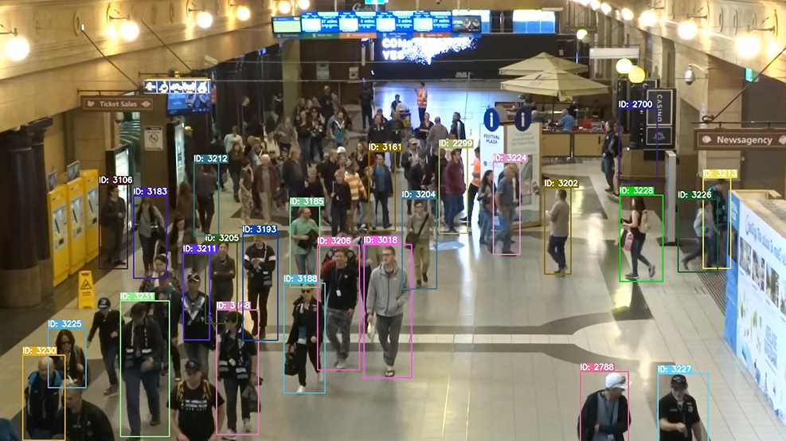

# DeepTrack

Reproducible multi-object tracking evaluation on dense MOT20 crowds.

DeepTrack contains a DeepSORT-style tracker, detector-caching utilities, and a
fixed evaluation harness for MOT20. The verified benchmark below is a
tracker-only public-detection baseline; the transformer, ReID, and deployment
components remain research or supporting infrastructure rather than headline
results.



## Key results

The main table uses the current **two-stage association** tracker on MOT20
training sequences 01, 02, 03, and 05 with each sequence's public
`det/det.txt` detections. These are online results; no offline interpolation,
stitching, or track filtering is applied.

| Sequence | MOTA | IDF1 | HOTA | DetA | AssA | FP | FN | ID switches |
|---|---:|---:|---:|---:|---:|---:|---:|---:|---:|
| MOT20-01 | 47.53% | 54.97% | 46.86% | 47.51% | 46.33% | 1,177 | 9,009 | 240 |
| MOT20-02 | 46.02% | 45.72% | 41.72% | 45.74% | 38.16% | 7,810 | 74,290 | 1,427 |
| MOT20-03 | 44.12% | 41.44% | 35.02% | 41.62% | 29.64% | 13,811 | 155,466 | 6,007 |
| MOT20-05 | 44.98% | 39.47% | 35.39% | 43.80% | 28.73% | 39,427 | 307,467 | 8,711 |

The result is stable in MOTA, while AssA falls as the scenes become denser
(46.3% on MOT20-01 to 28.7% on MOT20-05) and DetA stays in the 41.6--47.5%
range. This points to identity association, not raw public-detection recall,
as the measured weakness. A separate earlier YOLOv8n experiment on MOT20-01
gave 32.42% MOTA and 30.12% IDF1; it used a different detector protocol and is
not part of the table above.

Results are saved per sequence under
[`outputs/public_detection_measurements_hota`](C:/Users/vivia/Downloads/Github-repo/DeepTrack/outputs/public_detection_measurements_hota).
The exact baseline variant is
[`updated_yolov8x_1280`](C:/Users/vivia/Downloads/Github-repo/DeepTrack/configs/evaluation.yaml);
the detector fields are not used when reading `det.txt`.

## What was built and verified

- A MOT20 GT loader that keeps pedestrian annotations with `consider=1`.
- A cached detector workflow with atomic checkpoints, resume support,
  contiguous-frame validation, empty-frame-rate checks, and version metadata.
- A common MOTA/IDF1/FP/FN/ID-switch/fragmentation evaluator.
- TrackEval HOTA, DetA, AssA, CLEAR-MOTA, and Identity-IDF1 integration.
- A GT-as-detections sanity test: MOTA, IDF1, HOTA, DetA, and AssA are all
  1.0 with zero FP, FN, and ID switches.
- A selectable legacy cascade and current ByteTrack-style two-stage
  association mode.

TrackEval and motmetrics agree on IDF1 exactly in the cross-check. MOTA differs
by less than 0.03 percentage points because the implementations aggregate
matches slightly differently.

## Ablation and negative results

All rows below use the same public detections. The baseline mode is
two-stage association with `max_age=50`, `n_init=5`, gating threshold
`9.4877`, appearance weight `0.8`, and expanded IoU scale `1.0`.

| Tracker mode | Sequence | MOTA | IDF1 | HOTA | DetA | AssA |
|---|---|---:|---:|---:|---:|---:|
| Legacy cascade | MOT20-01 | 48.10% | 53.69% | 46.43% | 47.46% | 45.51% |
| Two-stage | MOT20-01 | 47.53% | 54.97% | 46.86% | 47.51% | 46.33% |
| Legacy cascade | MOT20-02 | 46.22% | 44.61% | 41.19% | 45.78% | 37.16% |
| Two-stage | MOT20-02 | 46.02% | 45.72% | 41.72% | 45.74% | 38.16% |
| Legacy cascade | MOT20-03 | not run (cascade too slow on CPU) | | | | |
| Two-stage | MOT20-03 | 44.12% | 41.44% | 35.02% | 41.62% | 29.64% |
| Legacy cascade | MOT20-05 | not run (cascade too slow on CPU) | | | | |
| Two-stage | MOT20-05 | 44.98% | 39.47% | 35.39% | 43.80% | 28.73% |

### Negative result: lifecycle and gating candidate

The only tested candidate grid varied `max_age=80`, `n_init=3`,
`gating_threshold=12.0`, `iou_match_threshold=0.2`,
`appearance_weight=0.5`, and `expanded_iou_scale=1.1` against the baseline.
It was judged on the tuning sequences MOT20-01 and MOT20-02 only. It reduced
IDF1 and AssA on both, so it was rejected:

| Sequence | MOTA | IDF1 | HOTA | DetA | AssA |
|---|---:|---:|---:|---:|---:|
| MOT20-01 | 42.30% | 42.95% | 39.94% | 48.49% | 33.11% |
| MOT20-02 | 40.75% | 34.50% | 33.55% | 45.97% | 24.64% |

## Protocol and limitations

- Dataset: MOT20 **training** sequences 01, 02, 03, and 05.
- Input: MOTChallenge public detections, with every `det.txt` row accepted
  using synthetic confidence 1.0 because the file's seventh field is binary
  metadata rather than a calibrated confidence score.
- GT: pedestrian class 1, `consider=1`, MOT 1-based frame numbering, xywh
  converted to xyxy.
- Matching threshold: IoU 0.5.
- Runtime: CPU-only measurement.
- Versions: Python 3.12.4, NumPy 2.2.6, motmetrics 1.4.0, TrackEval 1.3.0,
  PyTorch 2.9.1+cpu, Ultralytics 8.3.229, OpenCV 4.12.0.88.
- These are training-sequence public-detection results and are **not
  leaderboard-comparable**. The public-detection provenance and any overlap
  with training data are not treated as a leaderboard claim here.
- The main table is online only. Offline post-processing is not included.
- The model-dependent YOLO test is explicitly skipped in this environment
  because Torch/Ultralytics produced an access violation; the affected
  versions are PyTorch 2.9.1+cpu and Ultralytics 8.3.229.

The API, UI, Celery/Redis, and container files are supporting infrastructure;
they are not part of the verified benchmark.

## Reproduce

Create the MOT20 training layout at `data/raw/MOT20/MOT20/train`, install the
pinned evaluation dependencies, and run:

```powershell
python scripts/reproduce_baseline.py
```

The command runs the four public-detection sequences, writes one JSON result
per sequence to `outputs/public_detection_measurements_reproduced/`, records
the config path and Git commit in each result, and checks the headline metrics
against the table above. MOT20 data, detector caches, and model weights are
intentionally not committed; download MOT20 from the
[MOTChallenge site](https://motchallenge.net/data/).

For the detector-cache workflow, use
`scripts/cache_detections.py`; it resumes per sequence, writes atomic
checkpoints, and refuses suspiciously empty or incomplete caches. The cache
metadata records the selected variant and library versions.

Run the tests with:

```powershell
python -m pytest tests/test_evaluation_regression.py tests/test_tracker.py -q
```

The model-dependent YOLO test is skipped with a documented environment reason;
the evaluator and tracker-unit tests remain runnable without detector
inference.

## Not done

The frozen scope deliberately excludes offline stitching/interpolation, an
appearance-weight lambda sweep, YOLO-detector results on all four sequences,
dense-sequence legacy runs, GPU runs, and detector fine-tuning. These are
future work, not missing rows in the baseline table.

## License

MIT. See [LICENSE](LICENSE).
