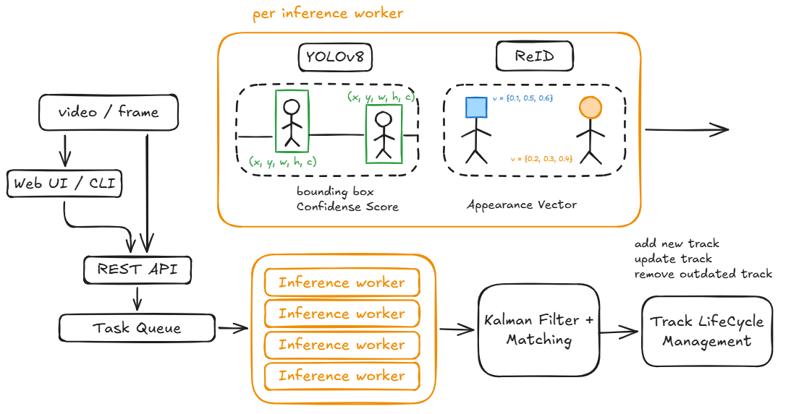

# DeepTrack

**Multi-object people tracking on dense MOT20 crowds, built from the algorithms up, with a reproducible evaluation pipeline.**

> 🔗 **Follow-up to [MOT](https://github.com/chao-dotcom/MOT)**, my from-scratch SORT implementation focused on algorithm correctness. DeepTrack takes it from algorithm to system: adding appearance-based association, a reproducible MOT20 evaluation pipeline, and integration with existing tools (YOLO detectors, TrackEval).

DeepSORT-style tracker (Kalman filter + appearance matching) with a ByteTrack-style two-stage association, evaluated with TrackEval (HOTA / MOTA / IDF1).

[](https://www.python.org/)
[](https://pytorch.org/)
[](LICENSE)

---

## Demo

[](https://youtu.be/WIFTWMEF9Es)

▶️ **[Watch the full demo on YouTube](https://youtu.be/WIFTWMEF9Es)** (MOT20-02, 2,782 frames, ~35 people per frame)

<!-- TODO: add a short GIF (5–10 s) so the demo plays right in the README -->
<!--  -->

---

## Results

MOT20 training sequences, public detections, **online** tracking (no interpolation, stitching, or track filtering).

| Sequence | MOTA | IDF1 | HOTA | DetA | AssA | ID switches |
|---|---:|---:|---:|---:|---:|---:|
| MOT20-01 | 47.5% | 55.0% | 46.9% | 47.5% | 46.3% | 240 |
| MOT20-02 | 46.0% | 45.7% | 41.7% | 45.7% | 38.2% | 1,427 |
| MOT20-03 | 44.1% | 41.4% | 35.0% | 41.6% | 29.6% | 6,007 |
| MOT20-05 | 45.0% | 39.5% | 35.4% | 43.8% | 28.7% | 8,711 |
| **Mean (4 seq.)** | **45.7%** | **45.4%** | **39.7%** | | | |

**Takeaway:** MOTA holds steady across scenes, while association quality (AssA) drops as crowds get denser (46% → 29%). Identity association, not detection, is the measured bottleneck, and it is the focus of ongoing work.

> Training-sequence, public-detection results: **not leaderboard-comparable**. Full protocol, ablations, and negative results are in [`docs/`](docs/).

---

## Workflow

<!-- TODO: replace with the detailed pipeline diagram -->


*Placeholder: detailed workflow graph (detections → Kalman prediction → two-stage association → track lifecycle → evaluation).*

---

## What's inside

- **Tracker:** Kalman filter, appearance + IoU association, selectable legacy cascade or two-stage matching
- **Evaluation harness:** MOT20 GT loader, TrackEval (HOTA/DetA/AssA/MOTA/IDF1), motmetrics cross-check
- **Sanity test:** GT used as detections gives 1.0 on every metric with zero FP, FN, and ID switches
- **Detector caching:** resumable runs with atomic checkpoints and completeness checks
- **Research / supporting code:** Transformer tracker, ReID model, API/UI/Docker (not part of the headline results)

---

## Reproduce

```bash
pip install -r requirements.txt
# place MOT20 at data/raw/MOT20/MOT20/train  (download: https://motchallenge.net/data/)
python scripts/reproduce_baseline.py
```

Writes per-sequence JSON results and checks them against the table above.
Tests: `python -m pytest tests/test_evaluation_regression.py tests/test_tracker.py -q`

---

## Roadmap

Detector fine-tuning · offline interpolation/stitching · appearance-weight sweep · GPU runs · YOLO results on all four sequences

---

MIT License · See [LICENSE](LICENSE)
